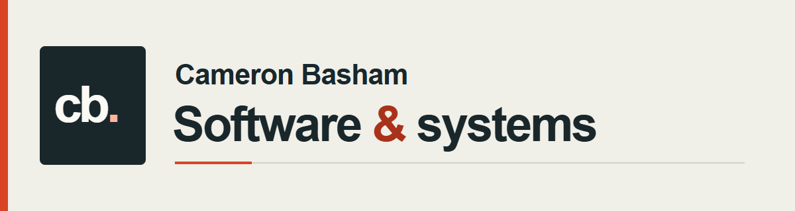

# Hi, I’m Cameron.

I build software for practical problems: full-stack applications, simulation tools, and computer-vision prototypes. I’m based in Michigan and completing my bachelor’s degree in Digital Media Software Engineering at Ferris State University, with graduation expected in December 2026.

**[Portfolio](https://www.cameron-basham.com) · [Résumé](https://www.cameron-basham.com/resume.pdf) · [LinkedIn](https://www.linkedin.com/in/cameron-basham) · [Email](mailto:Cameron250taylor@outlook.com)**

## Selected work

### CARLA Observability Toolkit
Record simulated driving sessions, inspect telemetry and events, and compare saved runs without rerunning the simulator. My capstone connects Python capture tooling, saved-run validation, a Flask API, and a React dashboard.

[Explore the case study and demo](https://www.cameron-basham.com/projects/carla-observability-toolkit) · [Browse the v1.0.0 source](https://github.com/Dumpy250/carla-observability-toolkit/tree/v1.0.0)

### Car Rental Backend & AWS Infrastructure
A Java/Spring Boot backend project spanning vehicle records, user management, and cloud infrastructure. I configured EC2 and VPC infrastructure for the project, which uses RDS for MySQL persistence and Cognito for user management. The case study includes a recorded local vehicle API walkthrough.

[Explore the case study](https://www.cameron-basham.com/projects/car-rental-microservices) · [Vehicle-service source](https://github.com/Dumpy250/car-rental-service)

*The public vehicle-service repository covers that service—not the separate gateway or Cognito user service.*

[More projects: computer vision, equipment-rental software, and C# / MVC →](https://www.cameron-basham.com/projects)

## What I work with

- **Applications:** Java / Spring Boot, C# / ASP.NET Core MVC, React, TypeScript / Next.js.
- **Simulation & vision:** Python, Flask, PyTorch, and YOLOv8 integration.
- **Cloud & data:** AWS EC2, VPC, RDS, Cognito, MySQL, and MariaDB.

## Beyond the repositories

I’m independently developing a Unity game, from gameplay design through implementation and hands-on playtesting. I also contributed Lua features, project coordination, QA, and build verification as a volunteer on Battlefield 3 Reality Mod.

Music is a big part of my life, and I play drums. Away from the keyboard, I enjoy games, hiking, time near the water, and getting outside with my dogs.
